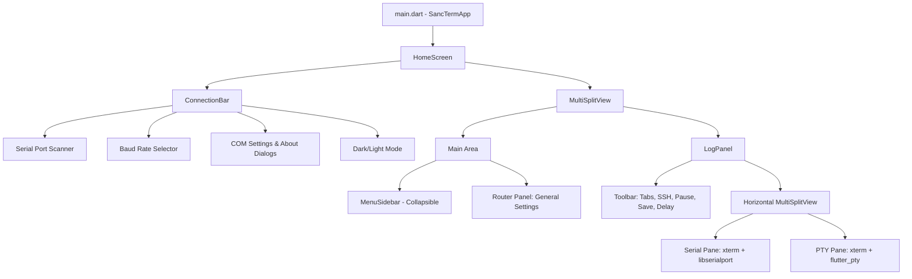

# UART/TERM Template Project Implementation Plan

## Goal Description

Create a clean, lightweight, highly optimized Flutter template project based on `sanc_term`. This template will serve as a quick-start foundation for any new project requiring UART/serial communication and terminal emulator capabilities.

Key architectural goals:

- **Same visual theme and layout**: Exact dark/light color palette, top connection bar, collapsible side navigation, dual vertical/horizontal split panes, and xterm styling from `sanc_term`.
- **Streamlined dependencies**: Retain essential UART, PTY, terminal, split-view, and Hive storage dependencies while stripping out board-specific packages (WebRTC, MQTT, BLE, TTS, Crypto, Archive).
- **Zero code-generation overhead**: Use clean, standard Riverpod providers and pure Dart models with `copyWith` methods, eliminating `build_runner`, `freezed`, and `riverpod_generator` for instant compilation and easy copy-pasting.
- **Portable relative imports**: Use relative imports across `lib/` files so folders can be copied into new projects without package-name collisions.
- **Unified shared UI API**: Group reusable UI building blocks in `lib/shared/` (`my_button.dart`, `my_panel.dart`, `my_widget.dart`, `my_utils.dart`) as mandated by `.agents/DESIGN.md`.
- **Single reference panel**: Include `COMMON / General Settings` as a canonical reference panel demonstrating how to send board commands via serial or PTY.



## User Review Required

### Code Generation vs Standard Riverpod & Models

In `sanc_term`, several providers and models used `freezed` and `riverpod_generator` (`.freezed.dart`, `.g.dart`). For this template project, we propose using standard pure Dart classes (with `copyWith`, `toJson`, `fromJson`) and standard Riverpod (`NotifierProvider`, `StateProvider`, `Provider`). This avoids needing `build_runner` and ensures copying and pasting code into new projects works instantly without build errors.

### Local xterm Dependency

Like `sanc_term`, the xterm dependency will point to `path: ../xterm.dart`, which provides custom features like `pasteCharDelayMs` and `pasteLineDelayMs`.

## Proposed Changes

### 1. Dependencies & Configuration

#### [MODIFY] pubspec.yaml

- Add required dependencies:
  - `flutter_riverpod: ^2.6.1`
  - `go_router: ^14.6.3`
  - `flutter_libserialport: ^0.6.0`
  - `flutter_pty: ^0.4.2`
  - `multi_split_view: ^3.6.2`
  - `xterm: path: ../xterm.dart`
  - `hive_ce: ^2.19.3`
  - `path_provider: ^2.1.5`
  - `window_manager: ^0.5.1`
  - `package_info_plus: ^8.3.0`
  - `file_picker: ^11.0.2`
  - `path: ^1.9.1`
  - `logger: ^2.5.0`
- Omit bloat: WebRTC, MQTT, BLE, TTS, Crypto, Archive, build_runner, freezed.

### 2. Core Theme, Router, and Utilities

#### [NEW] lib/core/theme/app_theme.dart

- Complete `AppColors` `ThemeExtension` with exact dark and light palettes from `sanc_term`.
- `AppTheme.darkTheme` and `AppTheme.lightTheme`.
- `TerminalTheme buildTerminalTheme(AppColors c, Brightness brightness)` with high-contrast ANSI 16-color palette.

#### [NEW] lib/core/theme/theme_provider.dart

- `themeModeProvider` backed by Hive box `app_settings` for persistent dark/light/system mode switching.

#### [NEW] lib/core/router/app_router.dart

- `GoRouter` configuration with `ShellRoute` mounting `HomeScreen`.
- Route `/home` and `/home/panel/:panelId`.
- Route persistence in Hive box `app_settings`.

#### [MODIFY] lib/my_utils.dart / lib/shared/my_utils.dart

- Move/export to `lib/shared/my_utils.dart`.
- Global instance `m`.
- Methods: `log()`, `dbg()`, `err()`, `showSnackbar()`, `showErrorSnackbar()`, `listIntToString()`, `stringToUint8List()`, `uint8ListToString()`.
- Fix existing broken import `package:sanc_term/...` to use relative imports.

### 3. Reusable Shared UI Components (lib/shared/)

#### [NEW] lib/shared/my_button.dart

- `PanelActionButton`: Standard icon + label outlined button for panel actions.
- `PanelToggleButton`: Toggling state button with active color highlight.

#### [NEW] lib/shared/my_panel.dart

- `PanelHeader`: Title, subtitle, icon, action widgets wrap.
- `PanelBody`: Rounded container card for grouped content.
- `MyPanel`: Main panel layout widget combining `PanelHeader` and children sections.
- `MyPanelBody`: Group card with section title, subtitle, icon, trailing widget, and content.

#### [NEW] lib/shared/my_widget.dart

- `buildDropdown<T>`: Styled compact dropdown for ports, baud rates, options.
- `ToolbarDivider`: 1px vertical divider for toolbars.
- `StatusBadge`: Compact monospace status tag.
- `InfoTile`: Monospace key-value readout.
- `ProgressBar`: Styled horizontal percentage indicator.
- `verticalDivider`: Helper function.

### 4. Connection Feature (lib/features/connection/)

#### [NEW] lib/features/connection/models/serial_config.dart

- Pure Dart `SerialConfig` model (`port`, `baudRate`, `encoding`, `newLine`) with `copyWith`, `toJson`, `fromJson`.
- Enums: `SerialEncoding` (`utf8`, `latin1`, `raw`, `hex`), `NewLine` (`lf`, `crlf`, `cr`, `none`).

#### [NEW] lib/features/connection/providers/serial_config_notifier.dart

- `availablePortsNotifierProvider`: Port scanner with Windows registry query (`HKLM\HARDWARE\DEVICEMAP\SERIALCOMM`) for instant discovery without USB driver lag, plus isolate fallback for non-Windows.
- `serialScanLoadingProvider`: Scan state tracking.

#### [NEW] lib/features/connection/providers/serial_pane_provider.dart

- `SerialPaneNotifier`: Independent serial port connection per terminal pane id.
- Handles connect, disconnect, streaming read, write, baudrate, parity, stop bits, flow control.
- Keeps connections alive across panel navigation.
- `effectiveActiveSerialTabIdProvider`: Resolves which serial pane is actively controlled.

#### [NEW] lib/features/connection/providers/board_console.dart & board_console_selector.dart

- `BoardConsole` interface (`run()`, `send()`).
- `ConsoleCommandSession`: Captures command output between echo and `SANCEND<nonce>` unique marker.
- `PtyConsole` & `SerialBoardConsole` implementations.
- `pickBoardConsole(ref)`: Routes board commands to the active serial or PTY console.

#### [NEW] lib/features/connection/widgets/connection_bar.dart

- Header bar with:
  - App menu button (`COM Settings` dialog and `About` dialog)
  - Title and terminal icon
  - Scan button
  - Port dropdown
  - Baud rate dropdown (9600 to 1,500,000)
  - Connect / Disconnect button
  - Theme mode toggle button
  - Status pill display

### 5. Terminal Feature (lib/features/terminal/)

#### [NEW] lib/features/terminal/models/terminal_tab.dart

- `TerminalTab`: `id`, `type` (`serial`, `pty`), `label`, `Terminal`, `TerminalController`, `FocusNode`.
- Paste delay configuration per tab.

#### [NEW] lib/features/terminal/providers/terminal_instances.dart

- `terminalTabsNotifierProvider`: Manages terminal tabs (defaulting to 1 Serial and 1 PTY pane).
- `activeTabIdProvider`: Tracks selected tab.
- `terminalPausedProvider`: Global terminal pause/resume.

#### [NEW] lib/features/terminal/providers/paste_settings_provider.dart

- `pasteSettingsNotifierProvider`: Configures character and line delays (off, fast, medium, slow, custom) stored in Hive to prevent buffer overruns on target boards.

#### [NEW] lib/features/terminal/providers/terminal_credentials_provider.dart

- `terminalCredentialsNotifierProvider`: Stores SSH IP, username, and password in Hive.

#### [NEW] lib/features/terminal/widgets/log_panel.dart

- Horizontal `MultiSplitView` housing multiple terminal panes.
- Toolbar with:
  - Tab addition dropdown (+ New Serial, + New PTY)
  - SSH quick connection fields: `[SSH]` button, `[IP]`, `[ID]`, `[Password]`
  - Pause / Resume button
  - File logger start/stop button
  - Timestamp prefix toggle button
  - Paste delay popup button
- `_TerminalPane`: Per-pane header with status indicator, COM port tag, clear buffer button, close button, and `TerminalView` widget.

### 6. Logging Service (lib/services/)

#### [NEW] lib/services/file_logger_service.dart

- `fileLoggerNotifierProvider`:
  - Prompts folder selection with `FilePicker`.
  - Streams terminal output to file.
  - Strips ANSI escape sequences and sanitizes control characters.
  - Prepends timestamps `[YYYY-MM-DD HH:MM:SS]` when enabled.

### 7. Layout & Navigation (lib/features/home/ & lib/features/panels/)

#### [NEW] lib/features/home/home_screen.dart

- Top `ConnectionBar`.
- Vertical `MultiSplitView`:
  - Upper: `MenuSidebar` + routed active panel.
  - Lower: `LogPanel`.
- Keyboard handler for `Alt+1..9` shortcuts to focus terminal panes.

#### [NEW] lib/features/home/widgets/menu_sidebar.dart

- Collapsible sidebar (52px collapsed with tooltips, 220px expanded with nested categories).

#### [NEW] lib/features/panels/models/panel_entry.dart

- `PanelEntry` and `PanelGroup` data definitions.

#### [NEW] lib/features/panels/panel_registry.dart

- Registry map connecting panel IDs to widget constructors.
- Default group `COMMON` with `General Settings`.

#### [NEW] lib/features/panels/common/cm_general_settings.dart

- Reference sample panel with System Info (`hostname`, `cat /proc/device-tree/model`, `uname -a`, `uptime -p`, `cat /etc/os-release`) and Environment (`locale`, `env`, `whoami`, `echo $SHELL`).

#### [NEW] lib/features/panels/common/board_command.dart

- `sendBoardCommand(ref, context, command)` helper.

#### [NEW] lib/features/panels/common/not_found_panel.dart

- Graceful 404 panel for unknown routes.

### 8. Application Entrypoint (lib/main.dart)

#### [MODIFY] lib/main.dart

- Initialize Hive storage directory.
- Initialize `windowManager` window title with OS label.
- Run `ProviderScope` wrapping `MaterialApp.router`.

## Verification Plan

### Automated Tests

1. Run static analysis:

   ```powershell
   flutter analyze
   ```

2. Verify formatting:

   ```powershell
   dart format --output=none --set-exit-if-changed lib test
   ```

3. Run unit/widget tests:

   ```powershell
   flutter test
   ```

### Manual Verification

1. Launch Windows desktop build:

   ```powershell
   flutter run -d windows
   ```

2. Verify layout:
   - Check ConnectionBar renders at top with port scanner, baud selector, status pill, theme switch.
   - Verify sidebar collapses and expands smoothly.
   - Verify vertical and horizontal splitters resize smoothly.
3. Verify UART & Terminal:
   - Scan COM ports and confirm available ports appear.
   - Connect to serial port and verify bidirectional communication.
   - Open PTY pane and confirm local command shell launches and responds to typing.
   - Test Pause/Resume and Clear buttons.
   - Test SSH fields and command triggers.
4. Verify Theme:
   - Toggle dark and light modes, verifying all text, borders, cards, and terminal ANSI colors remain high-contrast and readable.
