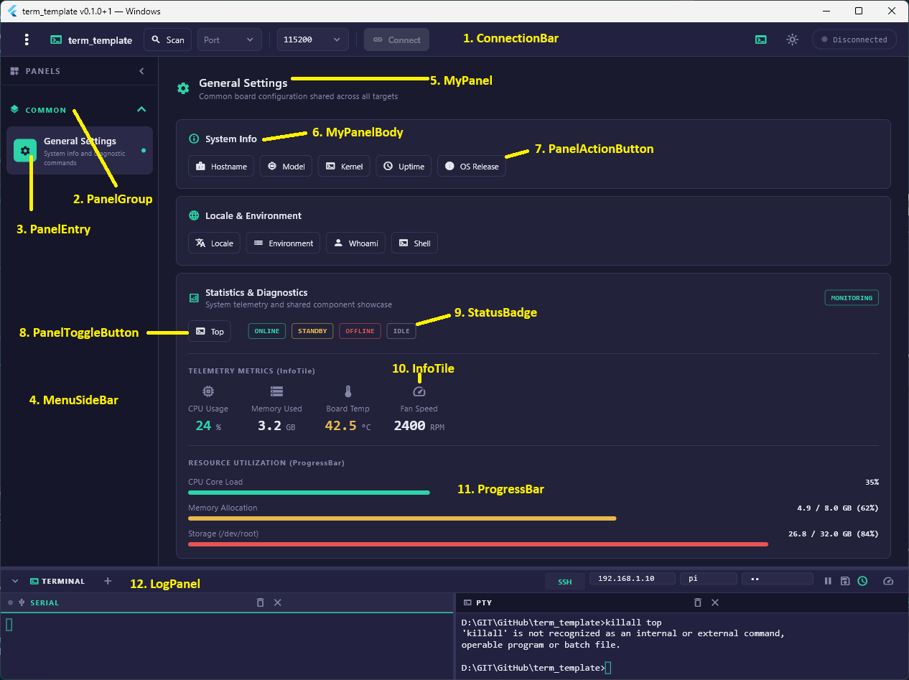

# term_template

template sample project for new app
This template support UART/TERMINAL features via riverpod with custom widgets

## Getting Started

- Creates new flutter project folder
- Copy template files into yours
- Add PanelGroup/PanelEntry for new panels
- Implement panel UI with desired features



1. Add a New Panel
   - Create your panel widget under `lib/features/panels/<your_feature>/<your_panel>.dart` using `MyPanel` and `MyPanelBody` from `../../shared/my_panel.dart`.
   - Register the panel in `lib/features/panels/panel_registry.dart`:

     ```dart
     panelRegistry['my_custom_panel'] = () => const MyCustomPanel();
     panelGroups.add(
       const PanelGroup(
         title: 'MY FEATURE',
         icon: Icons.developer_board,
         items: [
           PanelEntry(
             id: 'my_custom_panel',
             label: 'Custom Controls',
             description: 'Controls for target board',
             icon: Icons.tune,
           ),
         ],
       ),
     );
     ```

2. Send Board Commands
   - Use `sendBoardCommand(ref, context, 'my_cmd\r')` to send commands over the active serial or PTY connection without managing low-level streams.
